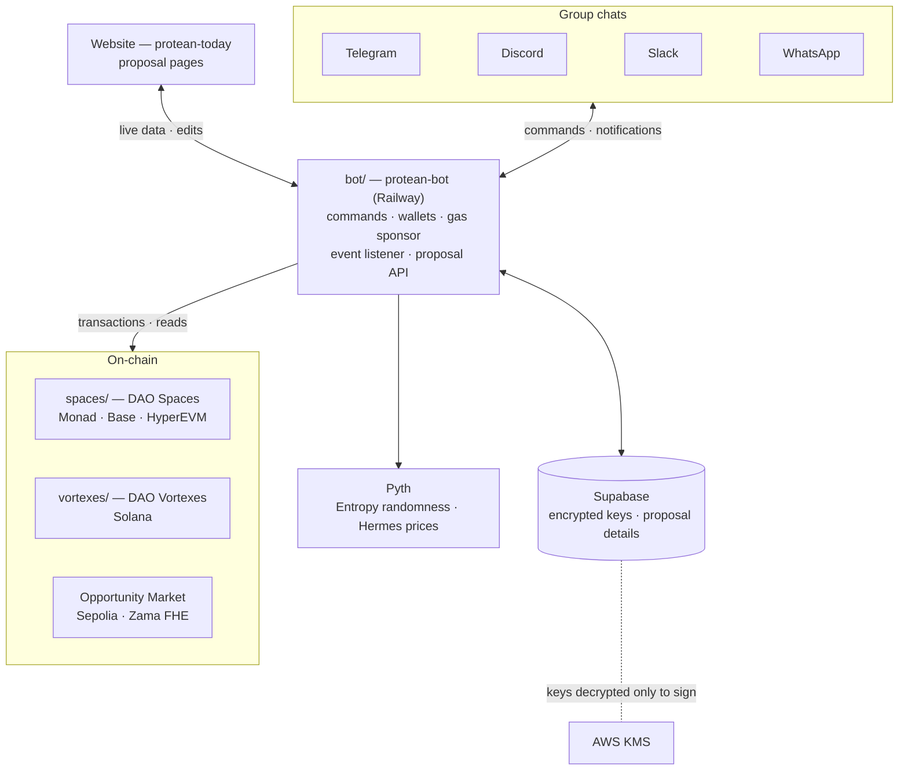
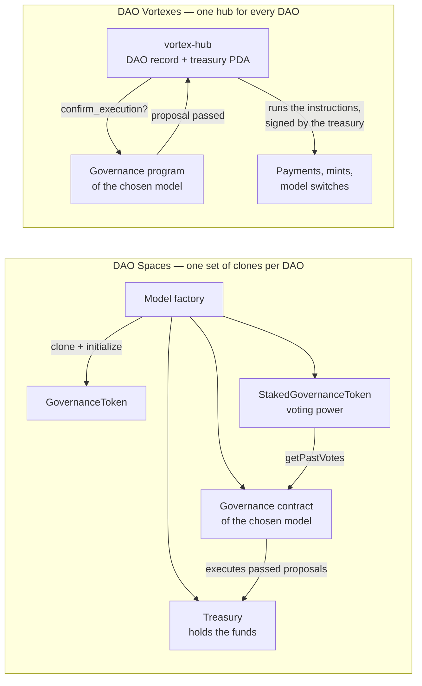
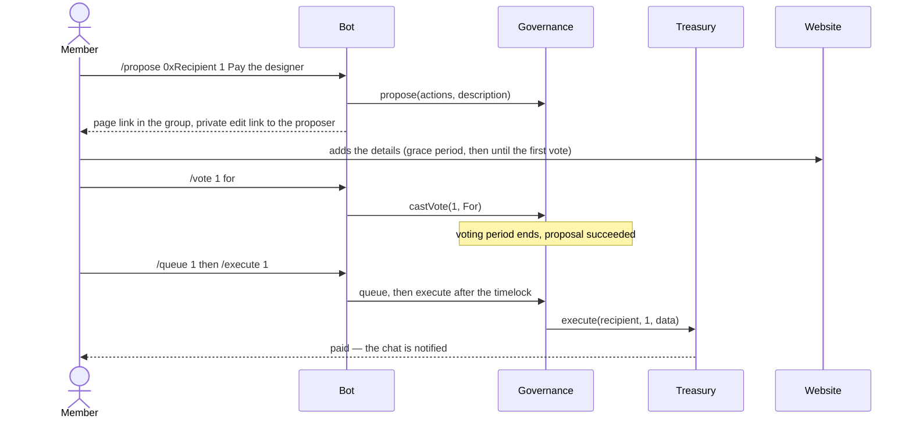

# Protean

Turn a group chat into a working DAO. Protean deploys real on-chain governance from inside Telegram, Discord, Slack or WhatsApp — pick one of ten governance models, get a wallet automatically, then stake, propose, vote, trade decision markets and place confidential bets without leaving the chat. Every decision executes on-chain; nothing is a poll someone has to carry out by hand.

This is the umbrella repository. It holds no code of its own — just three submodules, each its own project with its own README, deployed and versioned independently.

| Submodule | Repository | What it is | Built with |
|---|---|---|---|
| [`bot/`](https://github.com/replico-labs/protean-bot) | `protean-bot` | The bot: every chat command, wallets, gas sponsorship, notifications, the proposal-page API | Node.js, viem, grammY, discord.js, Slack Bolt, Baileys |
| [`spaces/`](https://github.com/replico-labs/Spaces) | `Spaces` | **DAO Spaces** — the EVM contracts: ten governance models, tokens, treasuries, factories, wrappers, the Opportunity Market | Solidity, Foundry |
| [`vortexes/`](https://github.com/replico-labs/Vortexes) | `Vortexes` | **DAO Vortexes** — the Solana programs: a hub that holds treasuries, and six governance models | Rust, Anchor, LiteSVM |

The website — every proposal's page, where proposers add the details — lives in [`protean-today`](https://github.com/replico-labs/protean-today), a separate repository that isn't a submodule here.

## Status

| | |
|---|---|
| **Monad testnet** | All ten models deployed; every model's full lifecycle passes live (votes, challenges, conviction budgets, elections and recalls, a Pyth Entropy draw, a Pyth-priced Sowellian outcome, a decision-market finalization) |
| **Base Sepolia** | All ten models deployed and verified live, same test |
| **HyperEVM testnet** | All ten models deployed and verified live, same test |
| **Solana devnet** | Six models deployed (Vortexes); every model has run a real proposal; token-weighted run end to end through the bot |
| **Sepolia** | Opportunity Market (Zama FHE) run end to end through Telegram |
| **Platforms** | Telegram and WhatsApp live; Discord and Slack built and tested on local chains, awaiting real-workspace runs |
| **Mainnets** | Supported in code, nothing deployed |

## How it fits together



**One bot, many chains.** Each chat is linked to one DAO on one network; every command in that chat reads and writes that chain. A DAO is created with a network word (`/createdao ArkDAO ARK 1000000 10000000 base`) and from then on the chat just works.

**Custodial, but encrypted.** Each user gets a wallet the moment they need one. Its private key is envelope-encrypted with AWS KMS and stored in Supabase; it is only ever decrypted in memory to sign. The bot's operator wallet pays users' gas, never the amounts they send.

## Inside a DAO

The EVM and Solana sides solve the same problem differently: a DAO's money and its decision rules are kept apart, so a DAO can change how it decides by vote without moving its treasury.



- **Spaces:** every DAO is a set of EIP-1167 clones made in one transaction by its model's factory. The Treasury trusts one governance address; switching models is a passed proposal calling `transferGovernance`. Optional wrappers add an NFT-marketplace signer and a GuardWrapper security council.
- **Vortexes:** a Solana treasury can only be signed for by the program that owns it, so one hub program holds every DAO's treasury and record, and governance programs only decide. Switching models takes a passed proposal plus a 2-day delay, and bumps the DAO's epoch so old proposals can never run.

## Governance models

| Model | How it decides | EVM | Solana |
|---|---|:-:|:-:|
| **Token-weighted** | Stake tokens; quorum and approval threshold | ✓ | ✓ |
| **Quadratic** | Same, but n staked tokens give √n votes | ✓ | ✓ |
| **Liquid** | Token-weighted, with vote delegation chains | ✓ | |
| **Optimistic** | Passes unless someone posts a bond to challenge it; challenged proposals go to a vote | ✓ | ✓ |
| **Conviction** | Support builds up over time; per-asset spending budgets raise the bar | ✓ | ✓ |
| **Board** | M-of-N signer multisig, no token | ✓ | ✓ |
| **Delegate** | Members elect a council for a term; the council votes; members can recall | ✓ | ✓ |
| **Sortition** | A council drawn at random (Pyth Entropy) from staked members | ✓ | |
| **Sowellian** | Approve, then bet on the outcome; resolved by people or a Pyth price | ✓ | |
| **Decision Markets** | Futarchy: pass and fail markets trade, the higher TWAP decides | ✓ | |

## A proposal, end to end



Other models swap the vote step for their own (`/challenge`, `/support`, `/confirm`, `/trade`, …); the bot's `/help` lists what each DAO's model needs.

## Networks

| Network | Chain | Gas | Notes |
|---|---|---|---|
| Monad testnet | 10143 | MON | The default network. Monad charges the full gas limit, so every write is simulated and sent with a measured limit |
| Base Sepolia | 84532 | ETH | Contracts built with the `size-limited` profile (EIP-170) |
| HyperEVM testnet | 998 | HYPE | `size-limited`; factories deployed in big blocks; the bot keeps under the 2M-gas small blocks and the 8-pending-nonce mempool rule |
| Solana devnet | — | SOL | Vortexes; the six Solana models |
| Ethereum Sepolia | 11155111 | ETH | Opportunity Market only (Zama's FHE coprocessor) |
| Monad, Base, HyperEVM mainnets | 143, 8453, 999 | | Supported, not deployed |

## Repository layout

```
protean/
├── bot/        protean-bot — Node.js
│   ├── src/                 commands, platforms, governance adapters, wallets
│   ├── src/solana/          Vortexes client
│   └── scripts/             test-evm-models.mjs (live lifecycle test), explain-tx.mjs, …
├── spaces/     Spaces — Foundry
│   ├── src/                 governance models, factories, tokens, treasury, wrappers, oracles
│   ├── test/                592 Foundry tests
│   └── script/              deploy scripts, hyperevm_big_blocks.py
└── vortexes/   Vortexes — Anchor
    ├── programs/            hub + six governance programs
    ├── crates/vortex-core/  shared library
    ├── tests/               52 end-to-end tests in LiteSVM
    └── scripts/smoke/       devnet smoke test
```

## Getting started

```bash
git clone --recurse-submodules https://github.com/replico-labs/protean.git
cd protean
```

Already cloned without `--recurse-submodules`:

```bash
git submodule update --init --recursive
```

Then follow each project's own README:

- **`bot/README.md`** — environment variables, running locally, deploying to Railway, every command
- **`spaces/README.md`** — Foundry setup, tests, deployments and their addresses per network
- **`vortexes/README.md`** — Anchor build, tests, devnet program IDs, the smoke test

### Testing

```bash
cd spaces && FOUNDRY_PROFILE=size-limited forge test               # the contracts
cd bot && node scripts/test-evm-models.mjs --network base-sepolia  # every model's lifecycle, live
cd vortexes && anchor build && cargo test                          # the Solana programs
```

## Keeping the submodules current

This repository records a specific commit of each project. After pushing to any of them, move the pointers forward:

```bash
git submodule update --remote --merge
git add bot spaces vortexes
git commit -m "Sync submodules"
git push
```

Deployments (Railway for the bot, the website's host) point at each project's own repository, not at this one.

## Security

Wallets are custodial: the bot's backend can decrypt any user's key, in exchange for onboarding with no wallet app and no gas. Keys are encrypted at rest with AWS KMS, and a leaked database alone reveals nothing usable. Read `bot/README.md`'s security section before running a copy anywhere real.

## Try it live

- **Telegram:** [@proteandao_bot](https://t.me/proteandao_bot)
- **Discord:** [Add to your server](https://discord.com/oauth2/authorize?client_id=1550697784259121203&permissions=3072&integration_type=0&scope=applications.commands+bot)
- **Slack:** [Add to Slack](https://protean-bot-production.up.railway.app/slack/install)

## License

MIT — Marvin Sunday. `spaces/src/governance/futarchy/DecisionMarketPair.sol` derives from Uniswap V2 core and is GPL-3.0-or-later.
